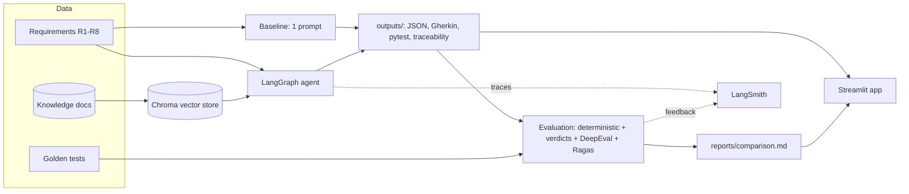
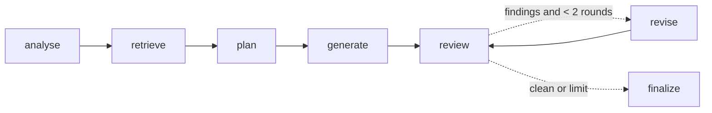

# Project Explanation: Agentic Test Case Generation

## 1. In One Paragraph

This project is a prototype that answers one question: **does an agentic AI workflow write better test cases from requirements than a single, well-written LLM prompt?** It takes requirements written as user stories with acceptance criteria, generates test cases two ways (a one-shot **baseline** and a multi-step **agent**), and compares both against a hand-written **golden set**, using deterministic checks, per-item LLM verdicts, **DeepEval** and **Ragas**. Everything runs in an isolated `uv` environment, can be traced in **LangSmith**, is demonstrated in a **Streamlit** app, and is guarded by a **GitHub Actions** quality gate.

---

## 2. Why This Use Case

Writing test cases by hand is slow, coverage is uneven (negative and boundary cases get skipped), and tests drift from changing requirements. LLMs can write tests quickly, but a single prompt tends to:
- **invent rules** it does not know (error codes, thresholds, field names),
- **miss domain rules** that live outside the requirement (rating scales, mappings, related requirements),
- **guess** instead of asking when a requirement is ambiguous,
- **get domain arithmetic wrong** (rating notches, ranks).

An agent can address each of these: it **retrieves** domain knowledge, **plans** before writing, **reviews** its own output, and **asks** instead of guessing. The prototype measures whether that actually happens.

---

## 3. The Domain: Credit Ratings (Synthetic)

Credit ratings suit test generation well. They have strict symbol scales, ordinal ranks, boundary rules and cross-agency mappings, which give clear right and wrong answers.

| Concept | Example |
|---|---|
| Moody's-style scale (21 symbols) | Aaa, Aa1 … Baa3 … C |
| Fitch-style scale (23 symbols) | AAA, AA+ … BBB- … C, RD, D |
| Investment-grade boundary | Baa3 / BBB- (rank 10) vs. Ba1 / BB+ (rank 11) |
| Notch change | BBB (9) → BB+ (11) = −2 notches |
| Regulatory selection rule | 1 rating: use it; 2: the lower; 3: the second best |
| Outlook vs. Watch | A rating has one or the other, never both |

All data is **synthetic**. Issuers and the third agency `NORTHBRIDGE` are fictional, and the scales are simplified.

### Dataset (`data/`)

| Part | Contents |
|---|---|
| `requirements/` | 8 requirements (R1–R8), **46 acceptance criteria**, plus an OpenAPI spec for R8 |
| `golden/` | **75 golden test cases** (positive / negative / boundary / edge), each linked to the criteria it covers; **18 expected ambiguities**; 1 deliberately untestable criterion |
| `knowledge/` | 6 documents for retrieval: scales, mapping, business rules, error codes, existing regression tests, and one **distractor** (short-term ratings) |

### Deliberate traps
- **Ambiguities**, e.g. no tie-break rule in R6, and "10 years" undefined in R7. A good tester asks about them.
- **An untestable criterion**: R4-AC6 says "large downgrades must be highlighted" without defining "large". A good tester flags it instead of inventing a threshold.
- **Cross-requirement rules**: R6 depends on R2's mapping; R8 depends on the R1 and R4 rules. These live only in the knowledge base.
- **Existing tests** that should not be duplicated.
- **A distractor document** that retrieval should ignore.

---

## 4. Architecture



### Components (`src/agentic_tcg/`)

| Module | Responsibility |
|---|---|
| `config.py` | Settings from `.env` (models, k, iterations), paths, LangSmith switches |
| `models.py` | Pydantic `Requirement`, `TestCase`, `TestSuite`, `GoldenSet`; loaders |
| `llm.py` | `ChatOpenAI` factory, `invoke_structured()` (strict JSON schema), LLM-facing schemas |
| `prompts.py` | Baseline and agent-node prompts |
| `baseline.py` | Single-prompt generator |
| `retriever.py` | Chroma knowledge base (in-memory, markdown split by heading) |
| `agent.py` | The LangGraph agent |
| `pipeline.py` | Runs a mode, records run id/LLM calls/time, saves and loads results |
| `renderers.py` | Table, Gherkin, pytest skeleton, plain text |
| `traceability.py` | Requirement-to-test matrix and coverage |
| `generate.py` / `evaluate.py` | Command-line entry points |
| `app.py` | Streamlit demo |

---

## 5. The Baseline

One call to `gpt-4.1` with the requirement (plus the OpenAPI spec for R8) and a fair prompt that asks for coverage of every criterion, all test types, concrete data, verifiable results and clarification questions. It has **no retrieval and no review**. The baseline is deliberately not a weak strawman, so any advantage the agent shows is real.

---

## 6. The Agent



| Node | What it does | Why |
|---|---|---|
| **analyse** | Summary, clarification questions, *provisional* untestable criteria, 3–6 search queries | Think before writing; decide what knowledge is needed |
| **retrieve** | Chroma similarity search for the requirement + queries; best 8 unique chunks | Bring in rules the requirement does not state |
| **plan** | Test conditions per criterion and type, with sources; **re-checks** untestable criteria against the knowledge; skips existing regression tests | Separate *what* to test from *how*; avoid duplicates |
| **generate** | Test cases for the conditions, using only requirement + knowledge facts | Grounded, concrete tests |
| **review** | QA-lead LLM critique (wrong or vague results, duplicates, missing conditions) **plus** a deterministic gap check (criteria or conditions with no test) | Catch errors and gaps reliably |
| **revise** | Replace, add or remove tests; at most 2 rounds | Self-correction with a cost cap |
| **finalize** | Domain `TestSuite`, ids renumbered, open findings noted | Clean output |

**Guardrails in code, not only in prompts:**
- Tests and conditions that only cover **confirmed untestable** criteria are dropped at every stage.
- The revision loop is capped (`MAX_SELF_CHECK_ITERATIONS=2`).
- All LLM output uses **OpenAI strict structured output**, so it always parses. Test data travels as a JSON string because strict mode forbids open-ended objects.

**Typical cost:** 6–8 LLM calls and 35–50 s per requirement, compared with 1 call and about 10 s for the baseline.

---

## 7. Outputs

For each requirement and mode, under `outputs/<mode>/`:
- `R*.json`: the full result (suite, trace, retrieved contexts, run id, LLM calls, time)
- `R*.md`: test table, traceability matrix, clarification questions
- `features/R*.feature`: Gherkin scenarios tagged with test id, type, priority and criteria
- `pytest/test_r*_generated.py`: runnable pytest skeletons (data, steps and expected result embedded; the call to the system under test is a TODO)

---

## 8. Evaluation

| Layer | Metrics | Notes |
|---|---|---|
| **Deterministic** | `ac_coverage`, `test_type_diversity`, `unknown_ac_references` | Coverage uses the *golden* untestable list, so a generator cannot raise its score by declaring criteria untestable |
| **Per-item LLM verdicts** | `golden_scenario_recall`, `golden_conflicts`, `ambiguity_detection` | One verdict per golden test or expected ambiguity, so the result is countable and auditable |
| **DeepEval** | `faithfulness`, `no_hallucination`, `test_quality` (`GEval`) | Judged against the requirement plus its referenced knowledge docs |
| **Ragas** | `ragas_faithfulness`, `ragas_context_recall`, `ragas_context_precision` | Context recall compares what each generator *saw* (requirement only vs. requirement + retrieval) |

- **Judge:** `gpt-4.1-mini`, temperature 0. `--repeats N` averages repeated judgements because LLM judges vary between runs.
- **Success criteria:** agent AC coverage ≥ 0.8, faithfulness ≥ 0.85, golden scenario recall ≥ 0.8, and better than the baseline. The CI gate uses only the absolute thresholds.

### Results so far (single judgement; the full R1–R8 run with `--repeats 3` is pending)

| Req | Golden scenario recall (baseline → agent) | Faithfulness | Tests |
|---|---|---|---|
| R3 | 0.56 → **1.00** | 1.00 → 1.00 | 20 → 26 |
| R4 | 0.40 → **1.00** | 0.53 → **1.00** | 15 → 26 |
| R6 | 0.22 → **0.89** | 0.80 → **1.00** | 10 → 20 |

The agent consistently covers far more of the expert's scenarios and stays grounded. The baseline is fast and readable, but it misses scenarios and once got rating arithmetic wrong (an upgrade given as −2 notches). Test-quality scores are similar for both.

---

## 9. Observability: LangSmith

When `LANGSMITH_TRACING=true`:
- each generation is a root run (`agent R4`, `baseline R4`) with tags, metadata and a stored `run_id`;
- every LangGraph node is a child run; the Chroma search is a `retriever` run;
- each evaluation is an `evaluate <mode> R<n>` trace;
- **every metric score is attached as feedback** to the run it evaluated;
- the Streamlit app links each output to its trace.

The test suite forces tracing off (`tests/conftest.py`).

---

## 10. Quality Engineering of the Prototype Itself

| Practice | Implementation |
|---|---|
| Isolated, reproducible environment | `uv` + `uv.lock`, Python 3.13, `.venv` |
| Offline tests | 74 tests with a **fake LLM** and **fake embeddings**: graph flow, loop cap, schemas, renderers, metrics, report, UI (Streamlit `AppTest`), tracing wiring |
| Live tests | 3 opt-in tests (`pytest -m llm`) against real OpenAI |
| Schema safety | Every LLM schema is checked against the OpenAI SDK's strict-schema converter |
| Data validation | `scripts/validate_data.py` checks coverage and rating arithmetic in the golden set |
| CI | Offline tests on every push; manual live **quality gate** (`--gate`) with secrets, traced to LangSmith |
| Change tracking | `UseCase1_Implementation.md` progress tracker and change log |

---

## 11. Lessons Learned (from real runs)

| Finding | Fix |
|---|---|
| A holistic `GEval` "coverage" score over 16–32 tests was unreliable (it missed tests that existed and rewarded wrong arithmetic) | Replaced with **one verdict per golden test** |
| The agent flagged R4-AC6 as untestable, then still wrote 9 tests with an invented threshold | Untestable criteria **enforced in code** |
| The agent judged testability **before** retrieval and over-flagged criteria defined in the knowledge base | The **plan** step re-checks with the knowledge |
| The judge called "different input data" a conflict | A conflict requires equivalent inputs and a different outcome |
| Re-judging identical output moved a score from 0.92 to 0.53 | `--repeats N` averaging |
| AC coverage saturates at 100% for both modes | Added golden scenario recall criteria (logged transparently) |
| Ragas default `max_tokens=1024` truncated output; DeepEval hallucination direction flipped in v4 | Raised the limit; reported as `no_hallucination` |
| Tests leaked traces to LangSmith (the SDK caches env vars) | `conftest.py` disables tracing before imports |
| Tooling: `ragas` vs. `langchain-community` incompatibility, `setup-uv` has no floating major tag, `.env.example` caught by `.env.*` ignore | Version pin, exact action version, ignore exception |

The theme: **measure, inspect the actual outputs, and fix what the numbers reveal**. Several apparent wins and losses were artefacts of the measurement.

---

## 12. Limitations

- Synthetic, simplified domain; golden tests are written by one author and need expert review.
- LLM-as-judge is noisy; results need repeats and a larger sample.
- Generated pytest files are skeletons: there is no real system under test.
- Cost and latency: the agent uses about 6–8× the calls of the baseline.
- Single generation model; no comparison across models yet.

## 13. Next Steps

1. Full R1–R8 run with `--repeats 3`; commit `reports/`.
2. Expert review of `data/golden/`.
3. Feed answers to clarification questions back into the agent (human in the loop).
4. Connect to real sources (Jira/Confluence) and a real system under test to make the pytest skeletons executable.
5. Compare models and costs; cache retrieval and judge calls.

## 14. How to Run

```bash
uv sync && cp .env.example .env                  # add OPENAI_API_KEY (and optional LangSmith keys)
uv run python -m agentic_tcg.generate            # baseline + agent for R1-R8
uv run python -m agentic_tcg.evaluate --repeats 3
uv run streamlit run app.py
uv run pytest                                    # offline tests
```
