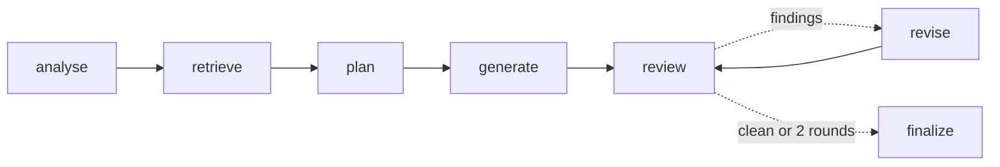

# Agentic Test Case Generation

A prototype that shows an **agentic AI workflow writes better test cases from requirements than a single prompt**, and proves it with metrics from [DeepEval](https://github.com/confident-ai/deepeval) and [Ragas](https://github.com/explodinggradients/ragas).

- **Domain:** credit ratings (Moody's-style and Fitch-style scales). 8 synthetic requirements, 75 hand-written golden test cases.
- **Agent:** LangGraph workflow with retrieval (Chroma) and a self-review loop, using OpenAI `gpt-4.1`.
- **Outputs:** structured test cases (table/JSON), Gherkin `.feature` files, pytest skeletons, and a traceability matrix.
- **Demo:** Streamlit app.

Design: [UseCase1_Test_Case_Generation.md](UseCase1_Test_Case_Generation.md) · Plan, progress and change log: [UseCase1_Implementation.md](UseCase1_Implementation.md)

## How It Works



| Step | What it does |
|---|---|
| analyse | Raises clarification questions, flags untestable acceptance criteria, writes knowledge-base queries |
| retrieve | Finds rating scales, mappings, rules, error codes and existing tests in the Chroma store |
| plan | Lists test conditions per criterion (positive, negative, boundary, edge) and skips existing regression tests |
| generate | Writes test cases using only facts from the requirement and the knowledge base |
| review | QA-lead critique plus a deterministic coverage check |
| revise | Fixes findings and fills gaps (at most 2 rounds); untestable criteria never get invented tests |

The **baseline** is one well-written prompt that gets the requirement only, with no retrieval or review.

## Setup

Requires [uv](https://docs.astral.sh/uv/). Everything installs into an isolated `.venv`.

```bash
git clone https://github.com/sureshmanem/Agentic-Test-Case-Generation.git
cd Agentic-Test-Case-Generation
uv sync
cp .env.example .env        # then set OPENAI_API_KEY
```

## Run the Prototype

```bash
# 1. Generate test cases (baseline and agent) for all requirements, or a subset
uv run python -m agentic_tcg.generate
uv run python -m agentic_tcg.generate --mode agent -r R4,R6

# 2. Evaluate agent vs. baseline (average 3 judgements, since LLM judges vary between runs)
uv run python -m agentic_tcg.evaluate --repeats 3
#    -> reports/comparison.md and reports/results.json

# 3. Demo
uv run streamlit run app.py
```

Generated files go to `outputs/<baseline|agent>/`: `R*.json`, `R*.md` (table + traceability), `features/R*.feature` and `pytest/test_r*_generated.py`.

## Evaluation

| Metric | Source | Measures |
|---|---|---|
| `ac_coverage` | deterministic | Acceptance criteria with at least one test (untestable criteria come from the golden set, so the score cannot be gamed) |
| `golden_scenario_recall` / `golden_conflicts` | LLM verdict per golden test | Golden scenarios covered with the same expected result / covered with a different result |
| `ambiguity_detection` | LLM verdict per expected item | Known ambiguities and untestable criteria that were raised |
| `faithfulness`, `no_hallucination`, `test_quality` | DeepEval | Consistency with the requirement and its reference knowledge; overall test quality (`GEval`) |
| `ragas_faithfulness`, `ragas_context_recall`, `ragas_context_precision` | Ragas | Groundedness in what the generator saw; how much needed knowledge the context held; retrieval relevance |

**Success criteria:** agent AC coverage ≥ 0.8, faithfulness ≥ 0.85, golden scenario recall ≥ 0.8, and above the baseline on these.

### Results So Far

Preliminary, on **R4 only**, with a single judgement (the full run across R1–R8 with `--repeats 3` is still to do):

| Metric | Baseline | Agent |
|---|---|---|
| Golden scenario recall | 0.40 | **1.00** |
| Faithfulness (DeepEval) | 0.53 | **1.00** |
| No hallucination (DeepEval) | 0.75 | **1.00** |
| Context recall (Ragas) | 0.38 | **1.00** |
| Test quality (`GEval`) | 0.93 | 0.90 |
| Tests / LLM calls / seconds | 15 / 1 / 11 | 26 / 6 / 39 |

The baseline also got notch arithmetic wrong in an earlier run (an upgrade given as −2). The agent correctly refused to invent a threshold for the vague "large downgrade" criterion.

## Tests and CI

```bash
uv run pytest                 # 60 offline tests (fake LLM and embeddings), no API key needed
uv run pytest -m llm          # live OpenAI tests (opt-in)
uv run python scripts/validate_data.py
```

GitHub Actions (`.github/workflows/ci.yml`):
- **On every push and PR:** offline tests and data validation.
- **Manual "Run workflow":** live generate + evaluate with `--gate` (fails below the absolute thresholds). Requires an `OPENAI_API_KEY` repository secret. The report is uploaded as an artifact.

## Project Structure

```
.
├── app.py                              # Streamlit demo
├── src/agentic_tcg/
│   ├── config.py                       # Settings (.env), paths
│   ├── models.py                       # Requirement, TestCase, TestSuite, loaders
│   ├── llm.py                          # OpenAI structured output, LLM-facing schemas
│   ├── prompts.py                      # Baseline and agent prompts
│   ├── baseline.py                     # Single-prompt generator
│   ├── retriever.py                    # Chroma knowledge base
│   ├── agent.py                        # LangGraph agent
│   ├── pipeline.py                     # Run + save/load results
│   ├── renderers.py                    # Table, Gherkin, pytest, text
│   ├── traceability.py                 # Requirement-to-test matrix
│   ├── generate.py                     # CLI: generate
│   └── evaluate.py                     # CLI: evaluate (DeepEval, Ragas, verdicts, report, gate)
├── data/                               # Requirements, golden tests, knowledge base (see data/README.md)
├── tests/                              # Offline unit/graph/UI tests + opt-in live tests
├── scripts/validate_data.py            # Data consistency checks
├── .github/workflows/ci.yml
├── UseCase1_Test_Case_Generation.md    # Use case design
└── UseCase1_Implementation.md          # Plan, progress tracker, change log
```

## Notes

- `langchain-community<0.4.2` is pinned because `ragas` 0.4.3 imports a module removed in 0.4.2.
- All data is synthetic. Issuers and the `NORTHBRIDGE` agency are fictional, and the scales are simplified, not official agency methodology.
