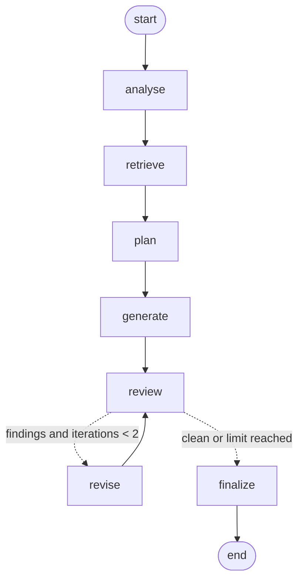

# UseCase1 Implementation Plan: Agentic Test Case Generation (Prototype)

> Living document. It tracks the implementation steps, their status, and every change to the plan.
> Design reference: [UseCase1_Test_Case_Generation.md](UseCase1_Test_Case_Generation.md)

## Goal: Prove the Point

Given requirements, the agent produces test cases that:
1. **Cover** every acceptance criterion (`GEval` coverage)
2. **Stay grounded**, with no invented fields or behaviour (faithfulness / hallucination)
3. **Outperform a single-prompt baseline** on those scores

Proposed success thresholds (to be confirmed): coverage ≥ 0.8, faithfulness ≥ 0.85, agent > baseline on both.

## Decisions

| Area | Decision |
|---|---|
| LLM | OpenAI: `gpt-4.1` for generation, `gpt-4.1-mini` as DeepEval/Ragas judge |
| Domain | Credit ratings (Moody's-style and Fitch-style scales), synthetic data, fictional issuers |
| Input data | Synthetic requirements + golden test sets |
| Agent framework | LangGraph |
| Retrieval | Yes: small local Chroma vector store |
| Output formats | Structured JSON/table, Gherkin (BDD), executable pytest |
| Demo | Streamlit app |
| Package manager | uv, isolated `.venv` |
| Secrets | `OPENAI_API_KEY` in `.env` (gitignored) |
| Observability | LangSmith tracing (optional, `LANGSMITH_TRACING` + `LANGSMITH_API_KEY`), project `agentic-test-case-generation`; metric scores sent as feedback |

## Progress Tracker

Status: ⬜ Not started · 🟡 In progress · ✅ Done

| Step | Description | Status |
|---|---|---|
| 0 | Environment setup (uv, git, GitHub repo) | ✅ |
| 1 | Synthetic ratings requirements, golden test sets, knowledge base | ✅ |
| 2 | Project scaffold (dependencies, package layout, config, `.env.example`) | ✅ |
| 3 | `TestCase` model + renderers (JSON/table, Gherkin, pytest) | ✅ |
| 4 | Baseline single-prompt generator | ✅ |
| 5 | LangGraph agent (analyse → retrieve → plan → generate → self-check → traceability) | ✅ |
| 6 | Evaluation suite (DeepEval + Ragas), agent vs. baseline report | ✅ |
| 7 | Streamlit demo | ✅ |
| 8 | Wrap-up: README results, optional CI quality gate | ✅ |
| 9 | LangSmith tracing (runs, retriever, evaluation, feedback, app links, CI) | ✅ |

---

## Step Details

### Step 0: Environment Setup ✅
- uv project with Python 3.13, isolated `.venv`, `deepeval` + `ragas` installed.
- `langchain-community<0.4.2` pinned (ragas 0.4.3 imports a module removed in 0.4.2).
- Git initialised; private GitHub repo `sureshmanem/Agentic-Test-Case-Generation`.

### Step 1: Synthetic Data ✅
Location: `data/`

| # | Requirement | Testing focus |
|---|---|---|
| R1 | Rating symbol validation (Moody's / Fitch scales) | Boundary, negative |
| R2 | Cross-agency rating mapping | Table-driven, symmetry |
| R3 | Investment vs. speculative grade classification | IG/SG boundary (Baa3/BBB−) |
| R4 | Rating actions (upgrade/downgrade/affirm, notch change) | Business rules, dates |
| R5 | Outlook and Watch status | State consistency |
| R6 | Regulatory rating selection rule (multi-agency) | Multi-branch logic |
| R7 | Rating history and audit trail | Date ranges, immutability |
| R8 | Issuer Ratings REST API (OpenAPI) | Executable pytest output |

Delivered (see [data/README.md](data/README.md)):
- `data/requirements/`: 8 requirements, **46 acceptance criteria**, plus `R8_issuer_ratings_api.openapi.yaml`
- `data/golden/`: **75 golden test cases** (positive / negative / boundary / edge), each linked to the criteria it covers; **18 expected ambiguities**; 1 deliberately untestable criterion (R4-AC6)
- `data/knowledge/` (6 docs): `rating_scales.md`, `cross_agency_mapping.md`, `rating_rules.md`, `error_codes.md`, `existing_tests.md` (tests the agent must not duplicate), `short_term_ratings.md` (distractor, to measure retrieval precision)
- `scripts/validate_data.py`: consistency checks (AC coverage, references, mapping/notch/selection arithmetic). **All checks pass.**

Traps built in to show the agent's value over a single prompt:
- Ambiguities the agent should raise as questions instead of guessing
- A vague criterion (R4-AC6, "large downgrade") that should produce a clarification, not an invented threshold
- Cross-requirement rules that are only in the knowledge base (e.g. R6 depends on the R2 mapping; R8 depends on the R1/R4 rules)
- Existing regression tests to avoid duplicating

### Step 2: Project Scaffold ✅
- Dependencies added with uv: `langgraph`, `langchain-openai`, `langchain-chroma`, `chromadb`, `streamlit`, `python-dotenv`, `openai` (dev: `pytest`).
- `pyproject.toml`: hatchling build system so `src/agentic_tcg` installs as a package; pytest marker `llm` for tests that call OpenAI.
- `src/agentic_tcg/config.py`: paths + `Settings` (models, self-check iterations, retrieval k) from env / `.env`.
- `.env.example`: template for `OPENAI_API_KEY` and model overrides. `.chroma/` and `outputs/` are gitignored.

### Step 3: Test Case Model + Renderers ✅
- `src/agentic_tcg/models.py`: Pydantic `Requirement`, `TestCase`, `TestSuite` (test cases + `clarification_questions` + `untestable_acs`), `GoldenSet`; loaders for requirements, golden sets and knowledge docs.
- `src/agentic_tcg/traceability.py`: requirement-to-test matrix (COVERED / NOT_COVERED / UNTESTABLE), coverage %, unknown AC references.
- `src/agentic_tcg/renderers.py`: Markdown/table rows, Gherkin `.feature` (tags: test id, type, priority, AC ids), pytest skeletons (test data embedded; the call to the system under test is a TODO and the test skips until implemented).
- `tests/test_models_renderers.py`: 29 offline tests. They check that the golden sets give 100% coverage, the generated pytest parses and runs, and the Gherkin has one scenario per test. **All pass.**

### Step 4: Baseline ✅
- `src/agentic_tcg/llm.py`: `ChatOpenAI` factory, `invoke_structured()` (OpenAI `json_schema` strict mode), LLM-facing schemas (`LLMTestSuite`, `LLMTestCase` with `test_data_json`), conversion to domain models, id renumbering (`R1-TC01` and so on).
- `src/agentic_tcg/prompts.py`: baseline prompt. It is a fair single prompt (asks for coverage, test types, concrete data and clarification questions), not a weak one.
- `src/agentic_tcg/baseline.py`: `generate_baseline(requirement, llm)` makes **one LLM call** with the requirement only (plus the OpenAPI attachment for R8) and **no retrieval**.
- `tests/fakes.py`: `FakeLLM` that mimics `with_structured_output().invoke()`. `tests/test_baseline.py`: strict-schema compatibility check (verified to reject a non-compliant schema), conversion, and a live test marked `llm` that is skipped without a key.

### Step 5: LangGraph Agent ✅

| Node | What it does | LLM call |
|---|---|---|
| analyse | Summary, clarification questions, untestable ACs, knowledge-base search queries | yes |
| retrieve | Chroma search (requirement + queries), best unique chunks (max 8) | no (embeddings) |
| plan | Test conditions per AC (type, source); skips conditions covered by existing regression tests | yes |
| generate | Test cases for the conditions, using only requirement + knowledge facts | yes |
| review | QA-lead review (wrong/vague results, duplicates, missing conditions) **plus** deterministic gap check (uncovered ACs/conditions) | yes |
| revise | Replace, add or remove tests; missing conditions join the plan | yes |
| finalize | Domain `TestSuite`, ids renumbered, notes any open findings | no |

- Files: `retriever.py` (in-memory Chroma, markdown split by heading, OpenAI `text-embedding-3-small`), `agent.py`, `pipeline.py` (`run_baseline`, `run_agent`, `save_result` → `outputs/<mode>/`: JSON, `.feature`, pytest, Markdown with traceability), `generate.py` CLI.
- Typical cost: 5 LLM calls (no revision) to 9 (two revisions) per requirement, compared with 1 for the baseline. Calls are counted and recorded in each result.
- `tests/test_agent.py`: strict-schema checks for all node schemas, the knowledge-base search, a full scripted run (gap found → revised → 100% coverage, untestable AC kept), the iteration cap, save/load, and the diagram. **All offline tests pass (42); 2 live tests are skipped until the API key is set.**

Run: `uv run python -m agentic_tcg.generate [--mode baseline|agent|both] [-r R1,R4]`

### Step 6: Evaluation ✅
Run: `uv run python -m agentic_tcg.evaluate [-r R1,R4] [--repeats 3] [--no-deepeval] [--no-ragas]` (reads `outputs/`, writes `reports/results.json` and `reports/comparison.md`).

| Metric | Kind | What it measures |
|---|---|---|
| `ac_coverage` | deterministic | Share of testable ACs (per the **golden** untestable list, so it cannot be gamed) with at least one test |
| `test_type_diversity` | deterministic | Distinct test types used / 4 |
| `unknown_ac_references` | deterministic | Tests citing AC ids that do not exist (lower is better) |
| `golden_scenario_recall` | LLM verdict per golden test | Share of the golden scenarios covered **with a matching expected result** |
| `golden_conflicts` | LLM verdict per golden test | Golden scenarios matched by a test that expects a different outcome (lower is better) |
| `ambiguity_detection` | LLM verdict per expected item | Share of expected ambiguities / untestable ACs that were raised |
| `faithfulness` | DeepEval `FaithfulnessMetric` | Claims consistent with the reference context (requirement + its referenced knowledge docs) |
| `no_hallucination` | DeepEval `HallucinationMetric` | 1.0 = nothing contradicts the reference context |
| `test_quality` | DeepEval `GEval` | Clear steps, concrete data, verifiable results, correct types, no duplicates |
| `ragas_faithfulness` | Ragas | Claims supported by what the generator saw (penalises invented test data such as issuer ids) |
| `ragas_context_recall` | Ragas | Golden-test facts supported by the generator context (baseline: requirement only; agent: + retrieval) |
| `ragas_context_precision` | Ragas (agent only) | Relevance of the retrieved chunks |

Judge model: `gpt-4.1-mini`. Success criteria: agent AC coverage ≥ 0.8, faithfulness ≥ 0.85, both above the baseline, plus golden scenario recall ≥ 0.8 and above the baseline (added after the first live run, see change log).

**Live check on R4 (2026-10-07, single judgement):** baseline vs. agent: golden scenario recall 0.40 vs 1.00; faithfulness 0.53 vs 1.00; no_hallucination 0.75 vs 1.00; test quality 0.93 vs 0.90; ambiguity detection 0.50 vs 0.50; tests 15 vs 26; LLM calls 1 vs 6; time 11 s vs 39 s. The agent wrote no tests for the untestable R4-AC6.

Tests: `tests/test_evaluate.py` (deterministic metrics, verdict counting, report and criteria, repeats, offline judge construction); live tests with `uv run pytest -m llm`. **55 offline + 3 live pass.**

### Step 7: Streamlit Demo ✅
Run: `uv run streamlit run app.py`

- **Sidebar:** pick a requirement; **Baseline** / **Agent** buttons generate live (the agent shows each step as it finishes); **Evaluate both** runs all judges for that requirement and merges the result into `reports/`. Buttons are disabled without an API key; saved outputs still display.
- **Header:** agent vs. baseline tests, AC coverage, LLM calls and time.
- **Tabs:** Requirement (story, ACs, OpenAPI attachment) · Test cases (table / Gherkin / pytest / clarification questions, with downloads) · Traceability (side by side) · Agent trace (graph diagram, each step with detail, retrieved chunks) · Evaluation (metric table baseline vs. agent with Δ, judge reasons, full report) · Golden set.
- Supporting changes: `run_agent(on_step=...)` streams steps (LangGraph `stream_mode="values"`); `evaluate_requirement()` and `update_reports()` merge per-requirement results; output and report folders are resolved at call time (overridable for tests).
- `tests/test_app.py`: headless Streamlit `AppTest` with no outputs and with saved outputs (offline). Also rendered against the real R4 outputs with no exceptions.

### Step 8: Wrap-up ✅
- `README.md`: purpose, how the agent works, setup, run commands, evaluation metrics, preliminary R4 results, tests and CI, structure.
- `evaluate.py --gate`: exits 1 when the agent misses an absolute threshold (AC coverage ≥ 0.8, faithfulness ≥ 0.85, golden scenario recall ≥ 0.8). Comparisons with the baseline are reported but do not block, because "coverage > baseline" cannot pass when both reach 100%.
- `.github/workflows/ci.yml`: offline tests + data validation on every push/PR; a manual **Run workflow** job runs live generate + evaluate `--repeats 2 --gate` (default R3, R4, R6) using the `OPENAI_API_KEY` repository secret and uploads `reports/` and `outputs/`.
- **Final offline test count: 60 pass; 3 live tests pass.**

### Still to do (needs the user)
1. Full run: `uv run python -m agentic_tcg.generate` then `uv run python -m agentic_tcg.evaluate --repeats 3`. Review `reports/comparison.md`, then commit `reports/`.
2. Have a QA engineer or ratings specialist review `data/golden/`, since every score is measured against it.
3. Optional: add the `OPENAI_API_KEY` repository secret to enable the manual CI quality gate.

### Step 9: LangSmith Tracing ✅
Enable with `LANGSMITH_TRACING=true` and `LANGSMITH_API_KEY` in `.env` (project defaults to `agentic-test-case-generation`).

| What is traced | How |
|---|---|
| Baseline and agent runs | Root run `baseline R<n>` / `agent R<n>` with a fixed `run_id`, tags `[mode, R<n>]` and metadata (title, model), via a LangChain `RunnableConfig` |
| Agent steps | LangGraph nodes become child runs automatically; LLM calls nest inside them |
| Retrieval | `KnowledgeBase.search` is a `@traceable(run_type="retriever")` run showing the retrieved documents |
| Evaluation | `evaluate <mode> R<n>` trace (`langsmith.trace`) with the per-item judge calls and Ragas calls (OpenAI client wrapped with `wrap_openai`); DeepEval uses its own client, so only its scores show |
| Scores | `send_feedback()` attaches every metric score and reason as feedback on the generation run (with `trace_id` and `session_id`) |

- `GenerationResult` stores `run_id` and `traced`; the Streamlit app shows tracing status and an **Open trace in LangSmith** button.
- The CLIs flush queued traces before exit (`flush_traces()`).
- CI quality-gate job traces to project `agentic-test-case-generation-ci` when the `LANGSMITH_API_KEY` secret exists.
- `tests/conftest.py` forces tracing off for the test suite; `tests/test_tracing.py` checks the switches, root run naming, tags and ids, child runs per node, feedback, and that tests never trace (offline, using a recording tracer).
- **Verified live (R3):** both runs appear in LangSmith with all node child runs; 11–12 feedback scores per run; evaluation traces present.

---

## Change Log

| Date | Change |
|---|---|
| 2026-10-06 | Plan created. Decisions: OpenAI gpt-4.1, credit-ratings domain, LangGraph, Chroma RAG, JSON/Gherkin/pytest outputs, Streamlit demo. |
| 2026-10-06 | R6 uses three agencies (Moody's-style, Fitch-style, and fictional "Northbridge Ratings" with Fitch-style symbols), so the three-rating "second-best" rule can be tested. |
| 2026-10-06 | Deliberate ambiguities added to some requirements (e.g., R4 "large downgrade") to test whether the agent flags them instead of guessing. |
| 2026-10-06 | Step 1 completed: 8 requirements, 75 golden tests, 6 knowledge docs, validation script. Golden files gained an `untestable_acs` field (used by R4-AC6) so evaluation can tell intentionally untestable criteria apart from real coverage gaps. |
| 2026-10-06 | Golden test case schema fixed (id, title, type, priority, preconditions, steps, test_data, expected_result, covers). Step 3's Pydantic `TestCase` will use the same shape. |
| 2026-10-06 | Step 2 completed. Ragas 0.4.3 metrics are used through the new `ragas.metrics.collections` API (`llm_factory` + `ascore`), confirmed against the installed package. Offline unit tests with fake LLM/embeddings added to the plan, because the API key is only available after Step 8. |
| 2026-10-06 | Step 3 completed. Generated pytest files are skeletons (data, steps and expected result embedded, with a TODO to call the system under test), because no real system under test exists in the prototype. |
| 2026-10-06 | Step 4 completed. LLM output schemas are separate from the domain models: OpenAI strict mode forbids open `dict` fields, so `test_data` is returned as a JSON string and parsed. Schemas are checked against the OpenAI SDK `to_strict_json_schema` converter. |
| 2026-10-06 | Step 5 completed. The self-check combines an LLM review with a deterministic coverage check (ACs and planned conditions without tests), so gaps are found reliably. The knowledge base is in-memory and rebuilt on each run instead of persisted, which avoids stale indexes (`.chroma/` is no longer needed). |
| 2026-10-06 | Step 6 completed. API key provided, so live tests are now opt-in (`pytest -m llm`); 3 live tests pass. |
| 2026-10-07 | First live run (R4) fixes: (1) Ragas judge raised `max_tokens` to 16000 (default 1024 truncated output). (2) DeepEval `HallucinationMetric` now scores 1 = pass; reported as `no_hallucination` (higher is better). |
| 2026-10-07 | Holistic `GEval` metrics for golden recall and ambiguity detection **replaced by per-item LLM verdicts**. On R4 the GEval judge said the agent lacked default-rating boundary tests it actually had, and gave the baseline a higher score despite wrong notch arithmetic (upgrade of −2, downgrade of +2). Per-item verdicts are countable and list the missed and conflicting golden tests. |
| 2026-10-07 | Agent bug found live: it marked R4-AC6 untestable but still wrote 9 tests with an invented "large downgrade" threshold. Fix: untestable ACs are enforced in code (plan, generate, review, revise drop conditions/tests that only cover them) and passed to the review/revise prompts; the review also checks for duplicates within the suite. Re-run: 0 tests for R4-AC6. |
| 2026-10-07 | Removed the literal `untestable_ac_flagged` check (it missed concerns raised without the AC id); `ambiguity_detection` covers it. |
| 2026-10-07 | **Success criteria extended** (originals kept): golden scenario recall ≥ 0.8 and above the baseline. Reason: AC coverage saturates at 100% for both modes, so it cannot tell them apart. |
| 2026-10-07 | Judge variance observed: re-judging the same R4 outputs moved baseline faithfulness 0.92 → 0.53. Added `--repeats N` to average judgements; final numbers should use `--repeats 3`. |
| 2026-10-06 | Step 7 completed. Uses `width="stretch"` instead of the deprecated `use_container_width`. |
| 2026-10-06 | Step 8 completed. All steps done. The full R1-R8 evaluation with `--repeats 3` is left for the user to run and review. |
| 2026-10-07 | **Step 9 added: LangSmith tracing** (requested after Step 8). Verified live on R3: runs, node child runs, retriever run, evaluation traces and feedback. |
| 2026-10-07 | Feedback now passes `trace_id` and `session_id` (project id); without them LangSmith warns that run feedback is deprecated. |
| 2026-10-07 | Issue found: the offline tests sent 39 fake-LLM runs to LangSmith once `.env` enabled tracing, because the langsmith SDK caches environment variables, so `monkeypatch.delenv` cannot switch it off. Fix: `tests/conftest.py` sets `LANGSMITH_TRACING=false` before anything is imported, plus a test asserting tests never trace. |
| 2026-10-07 | `.env.example` was never committed: the `.env.*` ignore rule matched it. Added `!.env.example`. |
| 2026-10-07 | **First CI quality-gate run (R3, R4, R6, traced to `agentic-test-case-generation-ci`): gate failed**, which surfaced two defects. (1) Agent: analyse judged testability **before** retrieval, so it flagged R3-AC5, R6-AC1 and R6-AC6 as untestable ("mapping not provided", though it is in the knowledge base), and the untestable enforcement then removed their tests (agent AC coverage 0.82). Fix: the plan step, which has the knowledge, re-checks the provisional list and only confirmed untestable ACs are enforced. (2) Judge: the per-scenario verdict counted *different input data* as a conflicting expectation (R6: 3.5 "conflicts" although the agent's expected results were correct). Fix: a conflict requires equivalent inputs and a different outcome. |
| 2026-10-07 | Fixes verified live (R3, R6; single judgement): agent AC coverage 1.00 on both, golden conflicts 0, golden scenario recall R3 1.00 / R6 0.89 (baseline 0.56 / 0.22); all gate thresholds pass locally. |
